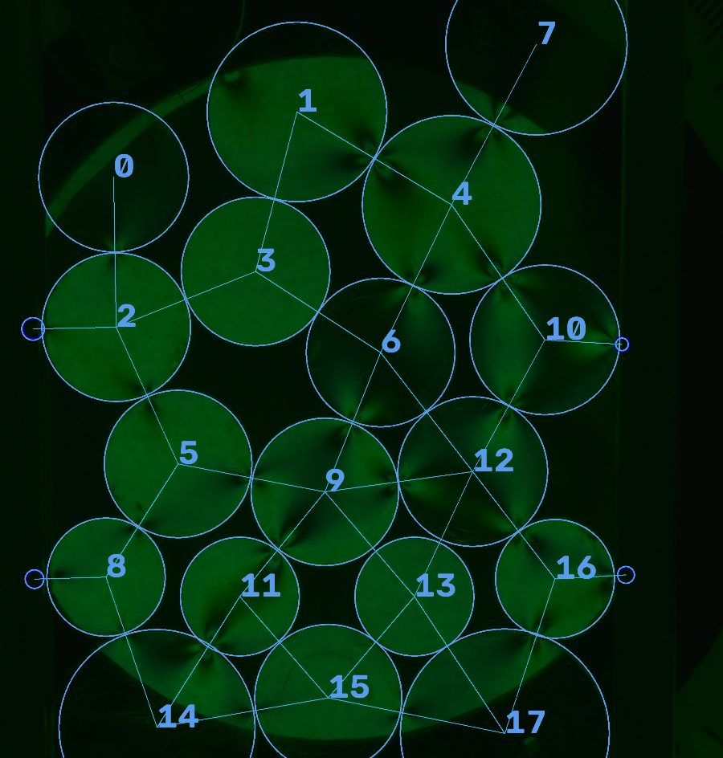

# Photoelasticity

Measuring contact forces in granular packings from photographs of photoelastic disks.

Photoelastic materials become birefringent under stress, so a loaded disk viewed through a polariscope shows
fringes whose pattern depends on the forces acting on it. This project takes lab photos of packed disks,
finds every disk and the contacts between them, solves for the contact forces, and fits the resulting force
distributions to a statistical model.



*A day-4 packing (`data/day4/DSC_0021.jpg`): 18 photoelastic disks detected and numbered, small blue boundary
markers picked up separately, and lines joining the centers of disks that touch.*

## Pipeline

```
photo ──▶ detect disks ──▶ contact graph ──▶ crop each disk ──▶ solve forces (PEGS) ──▶ force statistics
```

1. **Detect disks** ([`image_detection.py`](photoelasticity/image_detection/image_detection.py)).
   Canny edge detection with thresholds taken from the image's own intensity percentiles, then a Hough
   circle transform. Overlapping detections are removed with vectorized NumPy distance and radius-sum
   matrices. Small blue boundary markers are found separately with an HSV color mask.
2. **Build the contact graph.** Two disks are neighbors when their center distance is close to the sum of
   their radii. The contact angle of every neighbor pair comes from the same matrices.
3. **Crop each disk** into its own masked image (`circles/<photo>/<n>.jpg`).
4. **Solve forces** ([`disk_solve.py`](photoelasticity/forces/disk_solve.py)). Each crop, with its contact
   angles and an initial force guess, goes to the [PEGS](https://github.com/jekollmer/PEGS) photoelastic
   grain solver through the MATLAB Engine for Python. The solver returns the force and direction at each
   contact.
5. **Force statistics** ([`force_statistics.py`](photoelasticity/forces/force_statistics.py)). Contact forces
   are split into normal and tangential components, normalized by their mean, and their CDF is fitted to the
   model in Eqs. (21)–(26) of [Phys. Rev. E 98, 012905](https://doi.org/10.1103/PhysRevE.98.012905).


## Calibration (days 1–2)

Before the packings, single disks were loaded with known forces (523–2712 N) in plane and circular
polariscopes. [`fit_curve.py`](photoelasticity/fringes/fit_curve.py) takes the intensity along the disk's
loading axis and fits it to

```
I(x) = I0 · sin²( A · (1 − ζ²) / (1 + ζ²)² ),   ζ = (x + offset) / R
```

which relates the fringe pattern to the applied load.

## Layout

| Path | Contents |
|---|---|
| `photoelasticity/image_detection/` | Disk and marker detection, contact graph, cropping |
| `photoelasticity/fringes/` | Single-disk fringe fitting (calibration) |
| `photoelasticity/forces/` | PEGS force solver wrapper and force-distribution statistics |
| `photoelasticity/days/` | One entry point per lab day, with that day's detection parameters |
| `data/day1` … `data/day4` | Raw lab photos |
| `PEGS/` | PEGS solver (git submodule, MATLAB) |

Photos within a day are processed in parallel with `multiprocessing`, and both disk detection and force
solving are cached on disk with `diskcache`, so re-running an analysis only recomputes what changed.

## Running

Requires Python 3.12+, [uv](https://github.com/astral-sh/uv), and a local MATLAB installation, since the
MATLAB Engine for Python is a dependency of the force solver.

```bash
git clone --recurse-submodules https://github.com/shoham-b/Photoelasticity
cd Photoelasticity
uv sync

# Disk detection and contact graph for the day-4 photos
uv run python -m photoelasticity

# Full pipeline for day 4: detection, force solving and force statistics
uv run python -c "from photoelasticity.days.day4 import do_day_4; do_day_4()"
```

Annotated detections are written to `drawn_circle/`, per-disk crops to `circles/`, and force plots to
`forces_graphs/`.

## Limitations

This was written for a physics lab course. Detection parameters (radius range, Hough accumulator resolution,
disks or contacts to ignore) are tuned per lab day and set in `photoelasticity/days/`, not detected
automatically, and disks cut off by the frame edge are detected less reliably.
